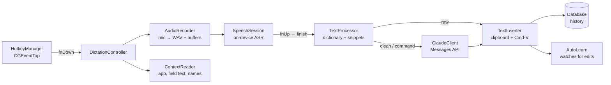

# Contributing to FreeFlow

This guide takes you from a fresh clone to your first merged change in about an hour. Work through it in order: each step builds on the one before.

Just want to learn how to use the app? Try the [interactive tutorial](https://brian-stockwell.github.io/FreeFlow/) instead.

**What FreeFlow is.** A native macOS dictation app, rebuilt feature-for-feature from Wispr Flow, that costs nothing to run beyond Claude API calls. Speech recognition runs on-device with Apple's SpeechAnalyzer (free). Claude only gets involved when you ask it to: cleaning up a dictation, running Command Mode, applying a Transform, or summarizing a meeting. A typical cleaned-up dictation costs about $0.0002 with Haiku.

**By the end you will have:**

- built, signed and launched your own copy of the app
- used every hotkey at least once
- followed one dictation through the code, from the Fn key press to the paste
- run the developer self-tests
- made and verified two small changes

---

## 1. Before you start

| You need | Why | How to check |
|---|---|---|
| macOS 26 or later | The app uses macOS 26 speech APIs (`SpeechAnalyzer`, `SpeechTranscriber`) | `sw_vers -productVersion` |
| Xcode 26 (Swift 6 toolchain) | Builds the Swift package | `xcodebuild -version` |
| An **Apple Development** signing identity | A stable signature keeps your macOS permissions across rebuilds | `security find-identity -v -p codesigning` |
| An Anthropic API key | Cleanup, Command Mode, Transforms and meeting summaries. Raw dictation works without one. | [console.anthropic.com](https://console.anthropic.com) → API Keys |

No signing identity yet? Open Xcode → Settings → Accounts, add your Apple ID, then select your team and click **Manage Certificates → + → Apple Development**. A free Apple ID is enough.

---

## 2. Build and launch

```bash
git clone https://github.com/brian-stockwell/FreeFlow.git
cd FreeFlow
```

The build script picks a signing identity in this order:

1. the `FREEFLOW_SIGN_ID` environment variable
2. the first line of a `.sign-identity` file in the repo root (git-ignored)
3. the first `Apple Development` identity in your keychain
4. ad-hoc signing (`-`) when you have none

With exactly one Apple Development identity you don't need to do anything. With several, pin the one you want, so your builds don't switch identities and lose their permissions. Copy the quoted name from `security find-identity -v -p codesigning`:

```bash
echo "Apple Development: you@example.com (ABCDE12345)" > .sign-identity
```

Then build, install and launch:

```bash
scripts/build.sh --run
```

What that does:

1. `scripts/make-app.sh` runs `swift build -c release`, wraps the binary in `.build/FreeFlow.app` (Info.plist, icon, the bundled sound files) and code-signs it.
2. `scripts/build.sh` quits any running FreeFlow, copies the app to `~/Applications/FreeFlow.app`, and with `--run` opens it.

Use `scripts/make-app.sh` alone when you want a signed `.app` without replacing the one you use every day.

> **The build failed and printed nothing useful?** `make-app.sh` filters compiler output down to three lines. Run `swift build -c release` directly to see the full errors.

---

## 3. First launch

FreeFlow is a menu bar app: look for the waveform icon at the top of the screen. It has no Dock icon unless you turn one on. The first time it runs it opens **Settings** for you. Work down the **Setup** section until every row is green:

1. **Microphone**: click Allow.
2. **Accessibility**: needed for the global hotkeys and for reading the text field you are typing in.
3. **Input Monitoring**: needed to see the Fn key.
4. **Speech model**: click Download. This is Apple's on-device model for your language.
5. **Claude API key**: paste it, then click **Test key**. It is stored in the macOS Keychain, never on disk in plain text.
6. **Hotkeys active** should now be green. If it isn't, click **Retry**.

**System Audio Recording** is requested the first time you record a meeting, not now.

If Wispr Flow is installed on your Mac, FreeFlow imports your Wispr dictionary, snippets, writing styles and email signature once on first launch.

> **Tip:** sign every build with the same identity. macOS ties Accessibility and Input Monitoring grants to the app's signature. A different or ad-hoc signature means re-granting both permissions after every rebuild.

---

## 4. A ten-minute tour

Open TextEdit with a new document and try each of these in turn.

### Dictation

| Do this | What happens |
|---|---|
| **Hold Fn**, say *"um so I I think we should meet at two actually three"*, release | The raw on-device transcript is pasted, fillers and all. Free. |
| **Hold Fn + Control**, say the same sentence, release | Claude Haiku cleans it up: *"I think we should meet at 3."* |
| Select a sentence, **hold Fn + Option**, say *"make this more formal"* | Command Mode rewrites the selection in place. |
| **Fn + Space** (or double-tap Fn) | Hands-free: keep talking without holding anything. Tap Fn to finish. |
| **Esc** while recording | Cancels. Nothing is pasted. |
| **Cmd + Ctrl + V** / **Cmd + Ctrl + C** | Pastes or copies your last transcript again. |

While you hold Fn you can still change your mind: tap **Control** to switch to cleanup, or **Option** to switch to Command Mode.

Now dictate into a different kind of app, for example Mail or Messages, with Fn + Control. The cleanup adapts to where you are typing: email gets a greeting and sign-off, chat stays casual. The **Style** page sets the tone for each category.

### Transforms

Select some text and press **Option + 1** (Polish). The other built-ins are **Option + 2** Prompt Engineer, **Option + 3** Turn into a list, **Option + 4** Make it concise and **Option + 5** Fix grammar only. With nothing selected, a Transform works on the whole field. In an empty field, it works on your last dictation from the past 60 seconds.

### Meetings

Press **Option + N** to start recording a meeting. FreeFlow records your mic as "Me" and the Mac's audio output as "Them". Press **Option + N** again to stop. You get a transcript, a Claude summary and a task list on the **Meetings** page. Tap **Control** on its own during a recording to switch to **Lecture** mode, which writes study notes instead of meeting minutes.

### The hub window

Menu bar icon → **Open FreeFlow**. Take a quick look at each page:

- **Home**: every dictation, with the raw transcript and what was actually pasted
- **Meetings**: transcripts, summaries and "ask a question about this meeting"
- **Scratchpad**: quick notes
- **Dictionary**: custom spellings and snippets. Words you correct after a paste are learned automatically.
- **Style**: tone per app category, plus custom app mappings
- **Transforms**: edit the built-ins or add your own
- **Insights**: words per minute, usage, and **API cost by feature**. Check this after you change anything that calls Claude.
- **Settings**: everything from step 3, plus model choice per feature

---

## 5. How it works

### One dictation, end to end



Read the files below in this order while you trace the flow. Together they make up most of what matters.

1. **`Core/HotkeyManager.swift`** installs a `CGEventTap`, at the HID level when macOS allows it, so it can swallow the Fn key before the system opens the emoji picker. It turns raw key events into `HotkeyEvent`s (`.fnDown`, `.fnUp`, `.escape`, `.transform(id)`, …).
2. **`Core/DictationController.swift`** is the state machine (`idle → recording → processing`) and the heart of the app. On `fnDown` it:
   - starts `AudioRecorder`, which writes a WAV file and streams converted buffers into a `SpeechSession`
   - hands the session your dictionary words and name as *contextual strings*, so names are spelled right
   - captures the `InsertionContext` in parallel: frontmost app, URL, text before and after the cursor, selection, and names visible on screen

   On `fnUp` it waits about 0.45 s for a possible second tap. A double tap means hands-free. Then it calls `finishAndProcess()`.
3. **`Core/SpeechEngine.swift`** wraps Apple's `SpeechAnalyzer` and `SpeechTranscriber`. You feed it buffers, then `finish()` returns the final text.
4. **`process(...)`** in `DictationController` applies the dictionary, then branches on the mode:
   - **raw**: `TextProcessor.fitToContext` fixes the casing and spacing for the cursor position.
   - **clean**: sends the transcript plus a `<context>` block to Claude with `Prompts.cleanupSystem`. Guardrail: unless the target is email or the cleanup level is Medium, a result that shares less than 30% of its words with the input is thrown away and the raw text is pasted instead.
   - **command**: asks Claude for JSON `{action, text}`. `replace_all` selects the whole field before pasting.
5. **`Core/TextInserter.swift`** snapshots the clipboard, puts the text on it, posts a synthetic Cmd+V and restores the clipboard 0.6 s later. This is the same approach Wispr Flow uses.
6. **`Core/AutoLearn.swift`** re-reads the text field 20 s and 60 s after the paste. If you corrected a name or an unknown word, it adds that word to your dictionary.

Two details that trip people up:

- **`generation`**: every finalized recording increments this counter. A processing task whose generation has gone stale drops its result. That is how a double tap takes over from the short tap before it without pasting twice.
- **`HotkeyManager.syntheticMarker`**: the paste keystroke FreeFlow posts carries this marker, so the event tap ignores it. If you ever post a key event, use `HotkeyManager.postKey` so it carries the marker too.

### Meetings

`Notetaker/MeetingRecorder.swift` runs two `SpeechSession`s at once: the mic through `AudioRecorder`, and the system audio through `SystemAudioTap`, a CoreAudio process tap. Segments are saved every 5 seconds. Without headphones, the mic picks up the other side through the speakers, so `EchoFilter` removes "Me" lines that are really echoes of "Them". When you stop, the audio files are deleted as soon as the transcript is saved. The summary then goes to the summary model (Sonnet by default) with a JSON schema. `MeetingDetector` notices when another app is using the mic while a meeting app or tab is open, and offers to record.

### Claude

`Claude/ClaudeClient.swift` is a small raw-HTTP client for the Messages API (there is no official Swift SDK). Every request:

- marks the system prompt with `cache_control` so it is prompt-cached. That is why the prompts in `Claude/Prompts.swift` are long and stable on purpose.
- sets `output_config.effort` and turns thinking on (`adaptive`) or off per feature
- retries 429 and 5xx responses up to three times
- writes token counts and an estimated cost to the `usageLedger` table. This feeds the Insights page.

Default models (changeable in Settings): **Haiku 5.5** for cleanup and Command Mode, **Sonnet 5.5** for meeting summaries.

### Where data lives

| What | Where |
|---|---|
| Database (GRDB / SQLite) | `~/Library/Application Support/FreeFlow/freeflow.sqlite` |
| Dictation audio (deleted after 14 days) | `…/FreeFlow/audio/` |
| Meeting audio (deleted once the transcript is saved) | `…/FreeFlow/meetings/<id>/` |
| Debug log (cleared once it passes 2 MB) | `…/FreeFlow/freeflow.log` |
| Settings | UserDefaults, domain `com.brianstockwell.freeflow` |
| API key | Keychain: service `com.brianstockwell.freeflow`, account `anthropic-api-key`. `ANTHROPIC_API_KEY` in the environment is the fallback. |

Tables: `history`, `dictionary`, `notes`, `noteVersions`, `meetings`, `meetingSegments`, `todos`, `usageLedger`, `transforms`. To peek inside:

```bash
sqlite3 ~/Library/Application\ Support/FreeFlow/freeflow.sqlite "select timestamp, mode, status, pastedText from history order by timestamp desc limit 5"
```

### Code map

```
Sources/FreeFlow/
├── App/        Entry point (menu bar scene), AppDelegate startup, the hub window, developer self-tests
├── Core/       Hotkeys, dictation state machine, audio, speech, context reading, paste, auto-learn, sounds
├── Claude/     API client and pricing, every system prompt, local text processing
├── Storage/    GRDB database and migrations, record models, settings and Keychain, Wispr import
├── Notetaker/  Meeting recorder, system-audio tap, echo filter, meeting detector
└── UI/         SwiftUI pages for the hub window, plus the floating Flow Bar
Resources/      Info.plist (permission strings), app icon, sound themes
docs/           This guide and the Wispr Flow behavior spec
scripts/        make-app.sh (build + sign), build.sh (also install + run)
```

**`docs/wispr-flow-spec.md`** is the product spec. It records how Wispr Flow actually behaves: hotkeys, formatting rules, styles, Command Mode, Transforms and Notetaker. When you are unsure how a feature should behave, look there first. Matching Wispr is the goal.

---

## 6. Developer self-tests

There is no XCTest target. Instead the binary has built-in test modes that run one subsystem and exit. Build once, then call the binary directly:

```bash
swift build -c release
.build/release/FreeFlow --test-claude "um so I I think we should uh meet at two actually three"
```

| Command | What it checks |
|---|---|
| `--test-speech path/to/audio.wav` | On-device transcription of a file, with timing and segments |
| `--test-claude "text"` | One cleanup call as if dictating into Mail. Prints latency, tokens and cost. |
| `--test-cleanup cases.json [off\|on] [effort] [style]` | Runs a whole eval set through the cleanup prompt. Prints the average similarity, latency and total cost. Arguments: thinking on or off, effort level, writing style. |
| `--test-transform polish "text"` | Runs a Transform by built-in key (`polish`, `promptEngineer`, `list`, `concise`, `grammar`, …) or by name |
| `--test-context` | Prints what `ContextReader` sees in the frontmost app: category, field text, selection, names on screen |
| `--test-import` | Re-runs the Wispr Flow import. **This writes to your real database.** |

Notes:

- `--test-claude`, `--test-cleanup` and `--test-transform` make real API calls and cost real (small) money.
- The bare binary is not inside the app bundle, so macOS treats it as a separate program. It reads settings from a separate `FreeFlow` defaults domain, and it may not be able to read the app's Keychain item. Export `ANTHROPIC_API_KEY` in your shell before running the Claude tests.
- `--test-context` reads whichever app is in front, which is your terminal when you run it. Run `sleep 3; .build/release/FreeFlow --test-context`, then click into the app you want to inspect.
- `cases.json` for `--test-cleanup` is an array of `{"raw": "...", "expect": "..."}` objects. Build your own from History: `asrText` is the raw input, and your corrected text is the expected output.

---

## 7. Your first changes

### Exercise 1: teach FreeFlow a new app (about 10 minutes)

FreeFlow sorts apps into categories (email, work, personal, AI prompts, documents, other) to pick the writing style. Suppose the Zed editor isn't recognized yet and should count as an AI or coding app.

1. Open Zed, then find out what FreeFlow currently sees:
   ```bash
   swift build -c release && sleep 3; .build/release/FreeFlow --test-context
   ```
   Click into Zed within three seconds. You should see `app: Zed (dev.zed.Zed)` and `category: other`.
2. In `Core/ContextReader.swift`, find `classify(...)` and add `"dev.zed.zed"` to `aiApps`. **Use lowercase.** The bundle ID is lowercased before it is compared with `hasPrefix`, so a mixed-case entry never matches.
3. Run step 1 again. It should now print `category: ai`.
4. Run `scripts/build.sh --run`. Dictate into Zed with Fn + Control and check the new row on **Home**: it should show the AI prompts category.

Users can also map an app without any code, on the **Style** page. That mapping is stored in `customAppCategories`. Reserve the built-in list for apps most people use.

### Exercise 2: add a built-in Transform (about 20 minutes)

1. In `Storage/Models.swift`, add a new entry to `Transform.builtIns`, for example:
   ```swift
   Transform(name: "Make it friendlier",
             prompt: "Rewrite the text so it sounds warm and friendly. Keep every fact and request. Same length or shorter.",
             shortcut: "opt+6", isBuiltIn: true, builtInKey: "friendly"),
   ```
2. Build and test it without touching the UI:
   ```bash
   swift build -c release && .build/release/FreeFlow --test-transform friendly "Send me the report by Friday."
   ```
   You'll get `no transform friendly`. That's expected, and it is the lesson of this exercise: built-in Transforms are written to the database by the `v2-transforms` migration, which already ran on your machine. Changing the array does not change existing databases.
3. Install the app (`scripts/build.sh --run`), open **Transforms** and click **Reset built-ins**. That calls `Database.resetBuiltInTransforms()`, which restores the built-ins and inserts any that are missing. Run the `--test-transform` command again: it now works. Then select some text and press **Option + 6**.

This is the general rule for the database: **never edit a migration that has already shipped.** To change the schema or seed data for existing users, register a new migration (`m.registerMigration("v4-…")`) in `Storage/Database.swift`.

---

## 8. House rules

- **Prompt changes need numbers.** Before and after editing anything in `Claude/Prompts.swift`, run `--test-cleanup` on the same cases file and compare average similarity, latency and cost. Changing a system prompt also invalidates the prompt cache, so the next request from every user pays full price for those input tokens once.
- **Watch the cost.** The project's whole premise is that it is cheap to run. Use Haiku unless you have measured a reason not to, and check **Insights → cost** after any change that calls Claude.
- **Threading.** `DictationController`, `MeetingRecorder`, `TransformController` and the UI run on the main actor. `SpeechSession` is an `actor`. Audio callbacks arrive on the audio thread, so hop to main before touching state. The package builds with the Swift 6 toolchain in Swift 5 language mode (`swiftLanguageMode(.v5)` in `Package.swift`).
- **Comments explain why.** Match the existing style: short `///` doc comments that explain intent, often pointing at the Wispr behavior they copy.
- **Privacy.** Dictations, meeting transcripts and audio are personal data. Don't log transcript text, and never commit anything from `.scratch/`, which is git-ignored for that reason. Keep the audio retention rules intact.
- **Keep the spec current.** If you change user-visible behavior on purpose, update `docs/wispr-flow-spec.md` or the README in the same change.

---

## 9. Troubleshooting

| Symptom | Fix |
|---|---|
| Fn does nothing | Settings → Setup. Grant Accessibility and Input Monitoring, then click **Retry** on the Hotkeys row. The log should contain `event tap installed at HID level`: `tail -f ~/Library/Application\ Support/FreeFlow/freeflow.log` |
| Permissions vanish after every rebuild | Your signature keeps changing: the build log prints `codesign as: …` on every build. Pin one identity in `.sign-identity`. If macOS is still confused, remove FreeFlow from both permission lists in System Settings and grant them again. |
| The emoji picker opens when you tap Fn | FreeFlow swallows Fn while hotkeys are active. For extra safety, set System Settings → Keyboard → "Press 🌐 key to" → **Do Nothing**. |
| A "Pasted raw transcript" notification | The Claude call failed: bad key, no network, or a timeout. The **Home** row shows the error. Test the key in Settings. |
| "No speech detected" | Check the speech model is installed and the right microphone is selected (Settings → Dictation). |
| The text lands on the clipboard instead of in the field | No editable text field had focus. Click into the field and press Cmd + Ctrl + V. |
| `codesign` fails during the build | The identity in `FREEFLOW_SIGN_ID` or `.sign-identity` doesn't match one listed by `security find-identity -v -p codesigning`. |

---

## 10. Onboarding checklist

- [ ] `scripts/build.sh --run` works with your own signing identity
- [ ] Every Setup row in Settings is green
- [ ] Raw, cleaned, Command Mode and hands-free dictation all work
- [ ] You've run a Transform and recorded a short test meeting
- [ ] You can explain what `generation` and `syntheticMarker` are for
- [ ] `--test-claude` and `--test-context` run from your terminal
- [ ] Exercises 1 and 2 are done, and you've seen why Exercise 2 needed **Reset built-ins**
- [ ] You've skimmed `docs/wispr-flow-spec.md`

Done? Pick something to work on and open a pull request. Welcome aboard.
